<p align="center">
  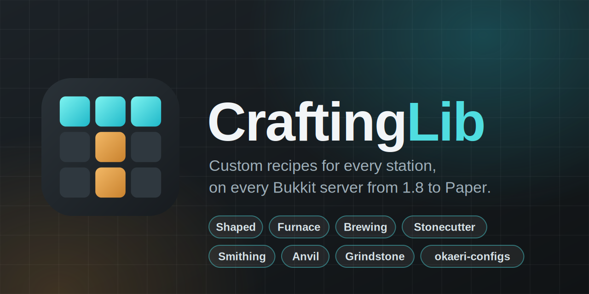
</p>

<p align="center">
  <a href="https://modrinth.com/plugin/craftinglib"></a>
  <a href="https://buymeacoffee.com/piotrulla"></a>
  <a href="https://bstats.org/plugin/bukkit/CraftingLib/34932"></a>
  <a href="COPYING.LESSER"></a>
  
  
</p>


**Custom recipes for every station, on every Bukkit server from 1.8 to the latest Paper.**
Shaped and shapeless crafting, furnaces, brewing, stonecutter, smithing table, anvil and grindstone, with exact item
matching, ingredient amounts, recipe book integration and okaeri-configs serialization. One API, and the version
differences are handled for you.

<p align="center">
  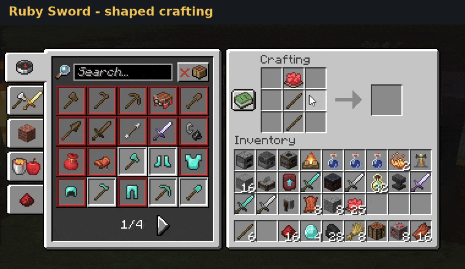
</p>

```java
this.craftingLib.getRecipeManager().registerRecipe(BukkitRecipes.shaped("ruby-sword")
          .withPattern("R", "R", "S")
          .withIngredient('R', this.items.ruby().asQuantity(RUBIES_PER_SWORD_SLOT))
          .withIngredient('S', Material.STICK)
          .withResult(this.items.rubySword())
          .withMatchMode(MatchMode.PERSISTENT_DATA)
          .withRecipeBookGroup(RUBY_TOOLS_GROUP)
          .withRecipeBookCategory(RecipeBookCategory.EQUIPMENT)
          .build());
```

---

## Contents

- [Features](#features)
- [Version support](#version-support)
- [Installation](#installation)
- [Quick start](#quick-start)
- [Recipe types](#recipe-types)
- [Match modes](#match-modes)
- [Recipe book](#recipe-book)
- [Replacing vanilla recipes](#replacing-vanilla-recipes)
- [Configs (okaeri-configs)](#configs-okaeri-configs)
- [Modules](#modules)
- [How it works](#how-it-works)
- [Limitations](#limitations)
- [Showcase plugin](#showcase-plugin)
- [Metrics](#metrics)
- [Building](#building)
- [Support](#support)
- [License](#license)

---

## Features

- **Every recipe type**: shaped, shapeless, furnace / blast furnace / smoker / campfire, brewing, stonecutter, smithing, anvil and grindstone.
- **Exact matching**: ingredients are compared with their name, lore, enchantments and NBT, or by material only, or by plugin data only.
- **Ingredient amounts**: e.g. *3 diamond blocks in each slot*. Shift-click crafts as many as the grid and inventory allow.
- **2x2 and 3x3 grids**: small recipes work in the player inventory too. Patterns can be placed anywhere in the grid and mirrored.
- **Recipe book**: recipes are unlocked for players, grouped and sorted into tabs. On Paper, clicking a recipe fills the grid correctly, including exact items and amounts.
- **Replacing vanilla recipes**: remove and block recipes with the same result or input.
- **Crafter support** (1.21+): custom recipes work in the autocrafter.
- **Version adapters**: capabilities are detected at runtime (class and method presence), not from version strings, so forks and backports work too.
- **okaeri-configs**: every recipe type can be stored in and loaded from YAML.
- **Fail-fast API**: immutable recipes, builders that validate early, and error messages that name the recipe key and the problem.

---

## Version support

✅ supported · ⚠️ partial (see note) · ❌ not available

### Recipe types

| Feature | 1.8 – 1.10 | 1.11 | 1.12 | 1.13 | 1.14 – 1.15 | 1.16 – 1.19 | 1.20 | 1.21+ | Notes |
|---|:-:|:-:|:-:|:-:|:-:|:-:|:-:|:-:|---|
| Shaped / shapeless crafting | ✅ | ✅ | ✅ | ✅ | ✅ | ✅ | ✅ | ✅ | 2x2 and 3x3 |
| Ingredient amounts | ✅ | ✅ | ✅ | ✅ | ✅ | ✅ | ✅ | ✅ | crafting, anvil, grindstone |
| Crafter (autocrafter) | ❌ | ❌ | ❌ | ❌ | ❌ | ❌ | ❌ | ✅ | only recipes with amount 1 per slot |
| Furnace | ⚠️ | ⚠️ | ⚠️ | ⚠️ | ✅ | ✅ | ✅ | ✅ | before 1.14 the input matches by material only |
| Blast furnace / smoker / campfire | ❌ | ❌ | ❌ | ❌ | ✅ | ✅ | ✅ | ✅ | |
| Stonecutter | ❌ | ❌ | ❌ | ❌ | ✅ | ✅ | ✅ | ✅ | |
| Smithing table | ❌ | ❌ | ❌ | ❌ | ❌ | ✅ | ✅ | ✅ | template required on 1.20+, not allowed before |
| Anvil | ❌ | ✅ | ✅ | ✅ | ✅ | ✅ | ✅ | ✅ | |
| Grindstone | ❌ | ❌ | ❌ | ❌ | ❌ | ⚠️ | ✅ | ✅ | needs `PrepareGrindstoneEvent` (1.19.3+) |
| Brewing | ❌ | ❌ | ❌ | ❌ | ❌ | ⚠️ | ✅ | ✅ | **Paper only** (`PotionMix`) |

### Matching and recipe book

| Feature | 1.8 – 1.11 | 1.12 | 1.13 | 1.14 – 1.19 | 1.20 | 1.21+ | Notes |
|---|:-:|:-:|:-:|:-:|:-:|:-:|---|
| `EXACT` / `TYPE` match modes | ✅ | ✅ | ✅ | ✅ | ✅ | ✅ | |
| `PERSISTENT_DATA` match mode | ❌ | ❌ | ❌ | ✅ | ✅ | ✅ | crafting, anvil, grindstone, Paper brewing |
| Replace vanilla recipes | ✅ | ✅ | ✅ | ✅ | ✅ | ✅ | recipes are removed if the server allows it, otherwise blocked by the listener |
| Keyed recipes (`NamespacedKey`) | ❌ | ✅ | ✅ | ✅ | ✅ | ✅ | before 1.12, recipes are recognized by result |
| Recipe discovery (unlock for players) | ❌ | ❌ | ✅ | ✅ | ✅ | ✅ | crafting and cooking recipes |
| Recipe book groups | ❌ | ❌ | ⚠️ | ✅ | ✅ | ✅ | 1.13: crafting only; 1.14+: also cooking and stonecutting |
| Recipe book categories (tabs) | ❌ | ❌ | ❌ | ⚠️ | ✅ | ✅ | cooking 1.19.3+, crafting 1.20+ |
| Recipe resend to online players | ❌ | ❌ | ❌ | ⚠️ | ⚠️ | ✅ | Paper, where `addRecipe(recipe, true)` is implemented |
| Recipe book autofill | ❌ | ❌ | ❌ | ❌ | ❌ | ✅ | **Paper only** (`PlayerRecipeBookClickEvent`) |

Features the server lacks are skipped silently when they are cosmetic (recipe book groups, categories, resend).
They fail fast when they are functional: registering a recipe type the server cannot handle throws
`UnsupportedOperationException` with the reason, e.g. `Stonecutting recipes require Minecraft 1.14+`.

**Requirements:** Java 11+ at runtime (the bytecode targets Java 11). Compiled against Paper API 1.21.3.

---

## Installation

Artifacts are published to the [EternalCode repository](https://repo.eternalcode.pl).

```kotlin
repositories {
    maven("https://repo.eternalcode.pl/releases")
}

dependencies {
    implementation("dev.piotrulla:craftinglib-bukkit:4.0.0")
    // optional: YAML serialization of recipes
    implementation("dev.piotrulla:craftinglib-bukkit-okaeri-serdes:4.0.0")
}
```

<details>
<summary>Maven</summary>

```xml
<repositories>
    <repository>
        <id>eternalcode-releases</id>
        <url>https://repo.eternalcode.pl/releases</url>
    </repository>
</repositories>

<dependencies>
    <dependency>
        <groupId>dev.piotrulla</groupId>
        <artifactId>craftinglib-bukkit</artifactId>
        <version>4.0.0</version>
    </dependency>
    <!-- optional: YAML serialization of recipes -->
    <dependency>
        <groupId>dev.piotrulla</groupId>
        <artifactId>craftinglib-bukkit-okaeri-serdes</artifactId>
        <version>4.0.0</version>
    </dependency>
</dependencies>
```

</details>

Shade the library into your plugin and **relocate it**, so two plugins with different versions do not clash:

```kotlin
plugins {
    id("com.gradleup.shadow") version "<latest>"
}

tasks.shadowJar {
    relocate("dev.piotrulla.craftinglib", "your.plugin.libs.craftinglib")
}
```

---

## Quick start

```java
public final class ExamplePlugin extends JavaPlugin {

    private BukkitCraftingLib craftingLib;

    @Override
    public void onEnable() {
        this.craftingLib = BukkitCraftingLib.create(this);

        this.craftingLib.getRecipeManager().registerRecipe(BukkitRecipes.shaped("better-torches")
                .withPattern("C", "S")
                .withIngredient('C', Material.COAL)
                .withIngredient('S', Material.STICK)
                .withResult(Material.TORCH, 8)
                .replaceVanillaRecipes(true)
                .build());
    }

    @Override
    public void onDisable() {
        this.craftingLib.shutdown();
    }
}
```

`BukkitCraftingLib.create(plugin)` detects what the server supports and registers the listeners.
`shutdown()` unregisters every recipe (and locks it in players' recipe books again) and removes the listeners.

Every recipe type has its own manager:

| Manager | Recipe |
|---|---|
| `getRecipeManager()` | shaped / shapeless crafting |
| `getSmeltingManager()` | furnace, blast furnace, smoker, campfire |
| `getBrewingManager()` | brewing stand |
| `getStonecuttingManager()` | stonecutter |
| `getSmithingManager()` | smithing table |
| `getAnvilManager()` | anvil |
| `getGrindstoneManager()` | grindstone |

Managers share one API: `registerRecipe`, `unregisterRecipe(key)`, `unregisterAll`, `findRecipe(key)` and `getRecipes`.
Registering a key that is already registered replaces the old recipe.

---

## Recipe types

Every builder comes from `BukkitRecipes` and accepts both `ItemStack`s and `Material` shortcuts.
**Keys** must match `[a-z0-9/._-]`. On 1.12+ they become the recipe's `NamespacedKey`.

These settings are shared by every builder:

| Method | Default | Description |
|---|---|---|
| `withResult(item)` / `withResult(material, amount)` | required | result item (copied, so later changes to your stack do not leak in) |
| `withMatchMode(mode)` | `EXACT` | how ingredients are compared, see [Match modes](#match-modes) |
| `replaceVanillaRecipes(boolean)` | `false` | see [Replacing vanilla recipes](#replacing-vanilla-recipes) |
| `discoverable(boolean)` | `true` | unlock in every player's recipe book |
| `withRecipeBookGroup(group)` | none | recipes in the same group share one recipe book entry |
| `withRecipeBookCategory(category)` | server default | recipe book tab |

### Shaped

<table>
  <tr>
    <td align="center">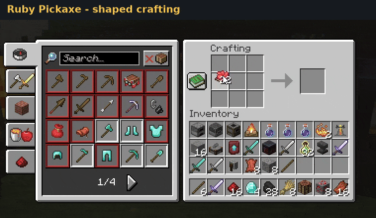<br><sub>Ruby pickaxe - ingredient amounts</sub></td>
    <td align="center">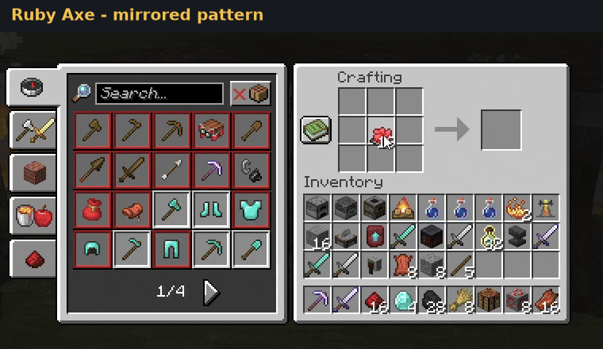<br><sub>Ruby axe - mirrored pattern</sub></td>
  </tr>
</table>

- The pattern has 1–3 rows of 1–3 characters, and a space means an empty slot. Empty borders are trimmed, so the pattern can sit anywhere in the grid.
- Recipes that fit in 2x2 also work in the player inventory.
- The amount in a slot is the number of items needed there. Shift-click crafts as many times as the ingredients and free space allow.

### Shapeless

```java
BukkitRecipes.shapeless("quick-bread")
        .withIngredient(Material.WHEAT)
        .withIngredient(Material.WHEAT)
        .withResult(Material.BREAD, 2)
        .build();
```

Up to 9 ingredients, placed in any slots.

<table>
  <tr>
    <td align="center">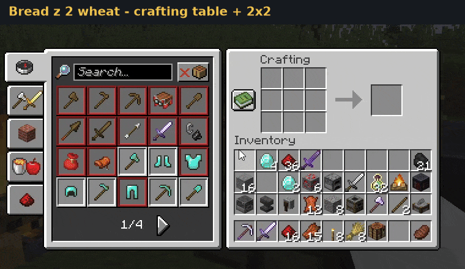<br><sub>Bread from wheat with amounts</sub></td>
    <td align="center">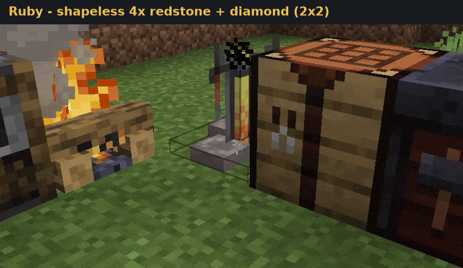<br><sub>Shapeless 2x2 in the player inventory</sub></td>
  </tr>
</table>
### Smelting (furnace, blast furnace, smoker, campfire)

<table>
  <tr>
    <td align="center">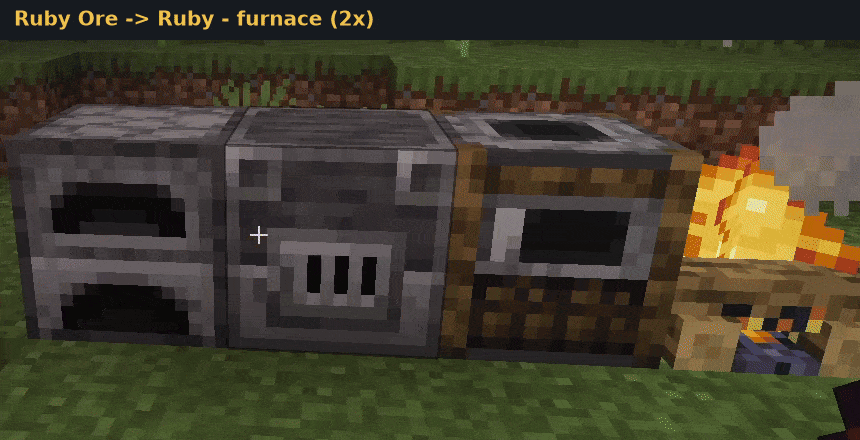<br><sub>Furnace</sub></td>
    <td align="center">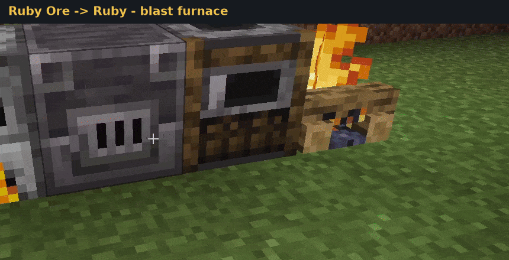<br><sub>Blast furnace</sub></td>
  </tr>
  <tr>
    <td align="center">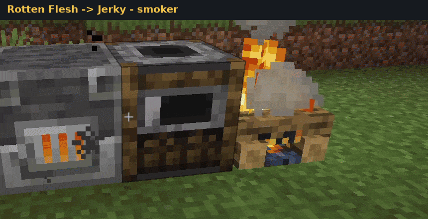<br><sub>Smoker</sub></td>
    <td align="center">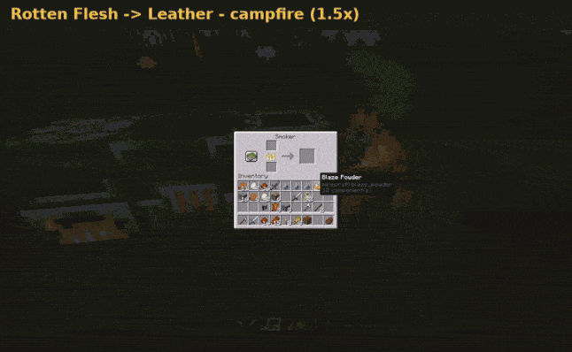<br><sub>Campfire</sub></td>
  </tr>
</table>

```java
BukkitRecipes.smelting("ruby-ore-blasting")
        .withCookingType(CookingType.BLASTING)
        .withInput(this.items.rubyOre())
        .withResult(this.items.ruby())
        .withExperience(RUBY_EXPERIENCE)
        .withCookingTime(FAST_BLASTING_TICKS)
        .withRecipeBookGroup(RUBY_GROUP)
        .withRecipeBookCategory(RecipeBookCategory.BLOCKS)
        .build();
```
```java
BukkitRecipes.smelting("ruby-ore")
        .withInput(this.items.rubyOre())
        .withResult(this.items.ruby())
        .withExperience(RUBY_EXPERIENCE)
        .withRecipeBookGroup(RUBY_GROUP)
        .withRecipeBookCategory(RecipeBookCategory.BLOCKS)
        .build();
```

The input amount must be 1. `replaceVanillaRecipes(true)` removes other recipes of the same station that take the same input.

### Brewing (Paper)

<p align="center">
  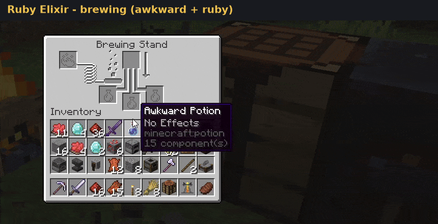<br><sub>Ruby elixir brewed from a custom ingredient</sub>
</p>

```java
BukkitRecipes.brewing("super-night-vision")
        .withInput(nightVisionPotion)
        .withIngredient(Material.GLOW_BERRIES)
        .withResult(superNightVisionPotion)
        .build();
```

Registered as a Paper `PotionMix`. Input and ingredient amounts must be 1. Brewing has no vanilla recipes to replace.

### Stonecutter (1.14+)

```java
BukkitRecipes.brewing("ruby-elixir")
        .withInput(this.items.awkwardPotion())
        .withIngredient(this.items.ruby())
        .withResult(this.items.rubyPotion())
        .build();
```

<table>
  <tr>
    <td align="center">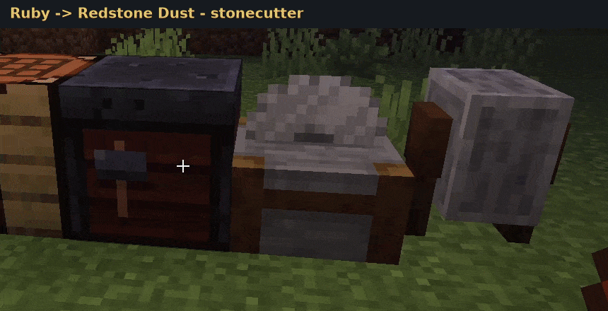<br><sub>Redstone in the stonecutter</sub></td>
    <td align="center">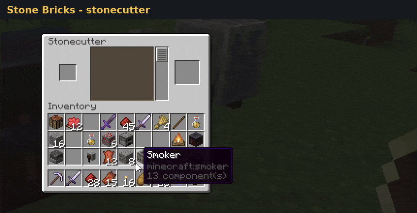<br><sub>Grouped stone bricks</sub></td>
  </tr>
</table>
### Smithing table (1.16+)

```java
BukkitRecipes.smithing("ruby-blade")
        .withTemplate(Material.NETHERITE_UPGRADE_SMITHING_TEMPLATE)
        .withBase(Material.DIAMOND_SWORD)
        .withAddition(this.items.ruby())
        .withResult(this.items.rubyBlade())
        .build();
```

<p align="center">
  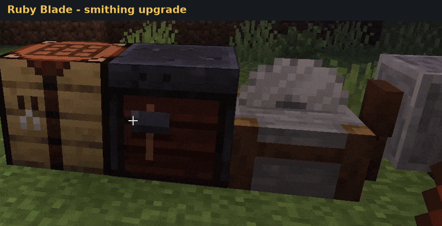<br><sub>Ruby blade on the smithing table</sub>
</p>

### Anvil (1.11+)

<p align="center">
  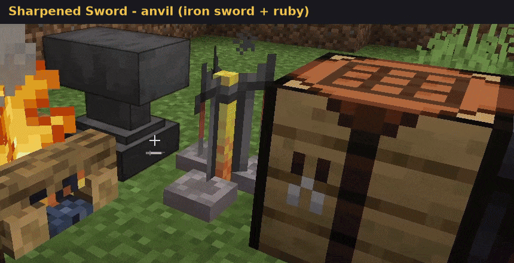<br><sub>Sharpened sword - anvil recipe taking levels</sub>
</p>

```java
BukkitRecipes.anvil("sharpen-sword")
        .withLeft(Material.IRON_SWORD)
        .withRight(this.items.ruby().asQuantity(RUBIES_PER_SHARPENING))
        .withResult(this.items.sharpenedSword())
        .withLevelCost(LEVEL_COST)
        .build()
```

The level cost is checked and taken from the player; creative players craft for free.

### Grindstone (1.19.3+)

<table>
  <tr>
    <td align="center">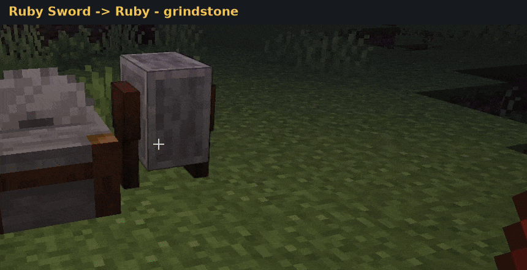<br><sub>Ruby sword scrapped on the grindstone</sub></td>
    <td align="center">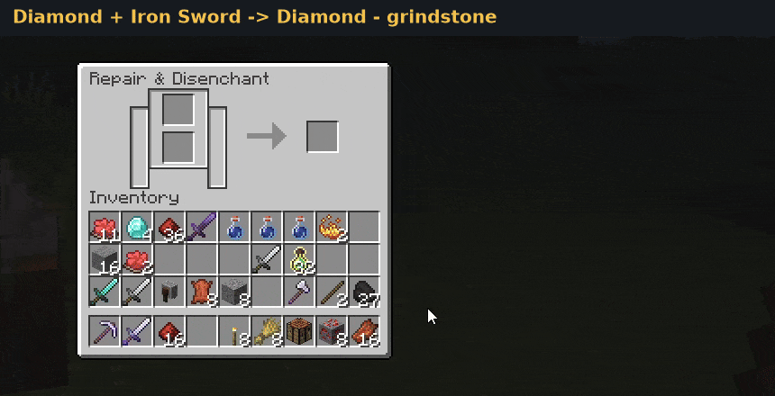<br><sub>Diamond sword to diamonds</sub></td>
  </tr>
</table>

```java
BukkitRecipes.grindstone("scrap-sword")
        .withInput(Material.DIAMOND_SWORD)
        .withSecondInput(Material.IRON_SWORD) // optional; without it the other slot must be empty
        .withResult(Material.DIAMOND, 2)
        .withExperience(10)                   // default 0
        .build();
```

The inputs can go in either grindstone slot. Their amounts are consumed and the experience goes to the player.
Grindstone slots only accept **damageable** (tools, weapons, armor) or **enchanted** items (including enchanted books), so the builder rejects other inputs with `IllegalArgumentException`.

---

## Match modes

| Mode | Compares | Use for |
|---|---|---|
| `EXACT` (default) | material + all item data (`ItemStack#isSimilar`: name, lore, enchantments, NBT, damage) | custom items that must be identical |
| `TYPE` | material only (on 1.8–1.12 this also ignores data values such as wool colour) | "any wheat" recipes |
| `PERSISTENT_DATA` | material + `PersistentDataContainer`, ignoring name, lore, damage and enchantments | custom items tagged by your plugin, even after the player renames or enchants them |

Where each mode works:

| Recipe type | `EXACT` | `TYPE` | `PERSISTENT_DATA` |
|---|:-:|:-:|:-:|
| Crafting, anvil, grindstone | ✅ | ✅ | ✅ (1.14+) |
| Smelting | ✅ (1.14+) | ✅ | ❌ |
| Stonecutter, smithing | ✅ | ✅ | ❌ |
| Brewing (Paper) | ✅ | ✅ | ✅ (Paper with `PotionMix#createPredicateChoice`) |

Smelting, stonecutter and smithing recipes run inside the server, which cannot compare plugin data, so
`PERSISTENT_DATA` fails at registration with a `CraftingException`.

```java
BukkitRecipes.shapeless("reforge")
        .withIngredient(taggedBlade)            // any item with the same material and plugin data
        .withResult(reforgedBlade)
        .withMatchMode(MatchMode.PERSISTENT_DATA)
        .build();
```

---

## Recipe book

<p align="center">
  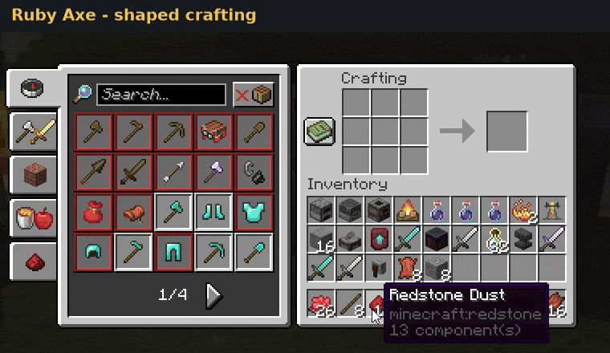<br><sub>Recipe book autofill with exact items</sub>
</p>

```java
BukkitRecipes.shaped("ruby-helmet")
        .withPattern("RRR", "R R")
        .withIngredient('R', ruby)
        .withResult(rubyHelmet)
        .withRecipeBookGroup("ruby-armor")                     // one entry for the whole set
        .withRecipeBookCategory(RecipeBookCategory.EQUIPMENT)  // tab
        .discoverable(true)                                    // default
        .build();
```

- **Discovery (1.13+)**: discoverable crafting and cooking recipes are unlocked for online players and again for everyone who joins. Unregistering locks them again.
- **Groups**: crafting (1.13+), cooking and stonecutter (1.14+).
- **Categories**: crafting recipes can use `BUILDING`, `REDSTONE`, `EQUIPMENT` and `MISC`; cooking recipes can use `FOOD`, `BLOCKS` and `MISC`. A category from the wrong book fails at `build()`. Other recipe types reject categories.
- **Resend (Paper)**: recipes added or removed while players are online are sent to their clients right away.
- **Autofill (Paper 1.21+)**: when a player clicks one of your crafting recipes in the recipe book, the library fills the grid itself. It picks items by the recipe's match mode and places the right amounts. Shift-click fills as many crafts as possible, and each further click adds one more craft. Items already in the grid go back to the player first. Vanilla autofill only knows materials, so without this it would put in plain items for an `EXACT` recipe.

---

## Replacing vanilla recipes

<p align="center">
  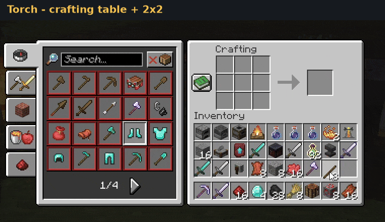<br><sub>Vanilla torch recipe replaced, in the table and 2x2 grid</sub>
</p>

`replaceVanillaRecipes(true)` means different things per station:

| Type | Replaces |
|---|---|
| Crafting | every other recipe with the same **result material**; they are removed from the server and blocked in the crafting listener |
| Smelting | recipes of the **same station** with the **same input** |
| Stonecutter | recipes with the same input and the same result material |
| Smithing | recipes accepting the same template, base and addition |
| Brewing, anvil, grindstone | not supported (nothing to replace), `build()` fails |

Recipes registered by the library itself are never removed.

---

## Configs (okaeri-configs)

Every recipe type has an okaeri-configs serializer (okaeri-configs **6.1**). Register the pack next to `SerdesBukkit`,
which handles the item stacks:

```java
public final class RecipesConfig extends OkaeriConfig {

    private List<CraftingRecipe<ItemStack>> crafting = new ArrayList<>();
    private List<SmeltingRecipe<ItemStack>> smelting = new ArrayList<>();
    private List<GrindstoneRecipe<ItemStack>> grindstone = new ArrayList<>();

    // getters...
}

RecipesConfig config = ConfigManager.create(RecipesConfig.class, it -> {
    it.configure(opt -> {
        opt.configurer(new YamlBukkitConfigurer(), new SerdesBukkit(), new CraftingLibSerdesPack());
        opt.bindFile(new File(this.getDataFolder(), "recipes.yml"));
    });
    it.saveDefaults();
    it.load(true);
});

config.getCrafting().forEach(this.craftingLib.getRecipeManager()::registerRecipe);
config.getSmelting().forEach(this.craftingLib.getSmeltingManager()::registerRecipe);
config.getGrindstone().forEach(this.craftingLib.getGrindstoneManager()::registerRecipe);
```

Optional settings are only written when they differ from the default. `<item>` below stands for an item stack in the
`SerdesBukkit` format.

```yaml
crafting:
- key: super-pickaxe
  type: SHAPED
  pattern: [DDD, ' S ', ' S ']
  ingredients:
    D: <item>
    S: <item>
  mirrored: true
  result: <item>
  match-mode: EXACT
  replace-vanilla: true            # optional, default false
  discoverable: false              # optional, default true
  recipe-book-group: pickaxes      # optional
  recipe-book-category: EQUIPMENT  # optional
- key: quick-bread
  type: SHAPELESS
  ingredients: [<item>, <item>]
  result: <item>
  match-mode: TYPE
```

Fields specific to each type (on top of `key`, `result`, `match-mode` and the optional settings above):

| Type | Fields |
|---|---|
| Crafting | `type` (`SHAPED` / `SHAPELESS`), `pattern`, `ingredients`, `mirrored` |
| Smelting | `cooking-type` (default `FURNACE`), `input`, `experience`, `cooking-time` |
| Brewing | `input`, `ingredient` |
| Stonecutter | `input` |
| Smithing | `template` (optional), `base`, `addition` |
| Anvil | `left`, `right`, `level-cost` (default 1) |
| Grindstone | `input`, `second-input` (optional), `experience` (default 0) |

A missing required field fails with a clear message, e.g. `Recipe 'sharpen' is missing required field 'left'`.

---

## Modules

| Module | Contents | Depends on |
|---|---|---|
| `craftinglib-core` | Platform-independent recipes, patterns, grid matching, abstract builders, managers | annotations only |
| `craftinglib-bukkit` | `BukkitCraftingLib`, `BukkitRecipes`, version adapters, listeners, recipe book | core, paper-api (compileOnly) |
| `craftinglib-bukkit-okaeri-serdes` | serializers for every recipe type, `CraftingLibSerdesPack` | bukkit, okaeri-configs |
| `craftinglib-tests` | MockBukkit integration tests (not published, Java 17) | everything |
| `craftinglib-bukkit-example` | Showcase plugin with every recipe type (not published) | bukkit, okaeri-serdes |

The core is generic over the item type (`ItemAdapter<T>`), so another platform only needs an adapter, concrete
builders and a `PlatformRecipeRegistrar`.

---

## How it works

- **Crafting**: each recipe is also registered as a material-level server recipe, only so that the server fires crafting events. The listener is the source of truth. It matches the grid against the registered recipes (item data, amounts, mirroring), sets the result and performs the craft by hand. When a grid matches our server recipe but none of our recipes, the result is cleared; the same happens for recipes whose result material is replaced.
- **Smelting, stonecutter, smithing, brewing**: registered as native server recipes (`RecipeChoice`, or `PotionMix` for brewing), so vanilla handles them.
- **Anvil, grindstone**: these stations have no recipe API, so listeners show the result on the prepare event and perform the take by hand.
- **Version adapters** are chosen by API capability: `RecipeChoice` present → modern (1.13+), `NamespacedKey` present → namespaced (1.12), otherwise legacy (1.8–1.11). Optional features (resend, categories, `AnvilView` and so on) are enabled only when the running server actually implements them. The check looks at the implementation, not just the interface. Version-specific classes are loaded only after the check passes.

---

## Limitations

- **1.8–1.11 have no recipe keys**: a server recipe counts as ours when its result is similar to one of our results, so two custom recipes with identical results cannot be unregistered separately there.
- **`replaceVanillaRecipes(true)` on crafting** removes every foreign recipe with the same result material, including other plugins' recipes.
- **Crafting result slot**: left, right and shift clicks are supported. Number keys and drop do nothing for custom recipes.
- **Crafting remainders**: only `*_BUCKET` → `BUCKET`.
- **Crafter**: only recipes consuming 1 item per slot; others are cancelled.
- **Anvil**: anvil damage is not simulated.
- **Grindstone**: inputs must be damageable or enchanted items (the builder enforces it), the client does not let other items into the slots.
- **Threading**: not thread-safe, so register recipes on the main thread.

---

## Showcase plugin

`craftinglib-bukkit-example` registers a recipe for every station: ruby tools with amounts, mirroring and
`PERSISTENT_DATA`, 2x2 recipes, replaced vanilla torches, all four cooking stations, a brewing elixir, stonecutter,
smithing, anvil, grindstone, and recipes loaded from `recipes.yml`.

```
./gradlew :craftinglib-bukkit-example:runServer
```

This downloads Paper, starts a local test server with the plugin and accepts the Minecraft EULA for that server.
In game, `/showcase` opens a menu with every station and its recipes (described straight from the recipe objects;
left click shows recipes, right click gives the kit). `/showcase <kit>` gives the ingredients for one station (`crafting`, `smelting`, `brewing`,
`stonecutting`, `smithing`, `anvil`, `grindstone`, `config`), and `/showcase all` gives everything.

---

## Metrics

CraftingLib reports anonymous usage statistics to [bStats](https://bstats.org/plugin/bukkit/CraftingLib/34932):
library version, detected version adapter, number of registered recipes and recipe types in use.
The bStats client is embedded and relocated inside the library, so it never clashes with the bStats copy
shaded into your own plugin.

Opting out:

- **Plugin developers** - disable it when creating the library:

  ```java
  BukkitCraftingLib craftingLib = BukkitCraftingLib.create(this, CraftingLibSettings.builder()
      .metrics(false)
      .build());
  ```

- **Server owners** - set `enabled: false` in `plugins/bStats/config.yml` (disables bStats for every plugin).

## Building

```
./gradlew build                 # compile + tests
./gradlew publishToMavenLocal   # install into ~/.m2
./gradlew publish               # publish to repo.eternalcode.pl (maintainers)
```

Publishing reads the credentials from the `ETERNAL_CODE_MAVEN_USERNAME` and `ETERNAL_CODE_MAVEN_PASSWORD`
environment variables.

Build logic lives in `buildSrc` convention plugins (`craftinglib-java`, `craftinglib-paper`, `craftinglib-okaeri`,
`craftinglib-junit`, `craftinglib-publish`), so each module pulls only the repositories and dependencies it needs.
Versions are defined in `buildSrc/src/main/kotlin/Versions.kt`.

## Support

If CraftingLib saves you time, you can support its development:

<a href="https://buymeacoffee.com/piotrulla"></a>

The showcase plugin is also available on [Modrinth](https://modrinth.com/plugin/craftinglib).

## License

Copyright (C) 2026 PIOTRULLA

CraftingLib is licensed under the [GNU Lesser General Public License v3.0](COPYING.LESSER), which builds on the
[GNU General Public License v3.0](COPYING).

In short:

- **You can** use CraftingLib in any plugin, open or closed source, free or paid, and shade it into your jar.
- **You must** keep the license notice, and publish the source of your **changes to CraftingLib itself** under the LGPL-3.0 if you distribute them.
- Your own plugin code that only uses the library stays under whatever license you choose.

The embedded bStats client (`dev.piotrulla.craftinglib.bukkit.metrics.bstats`) is licensed under the MIT license,
see `META-INF/LICENSE-bStats`.
